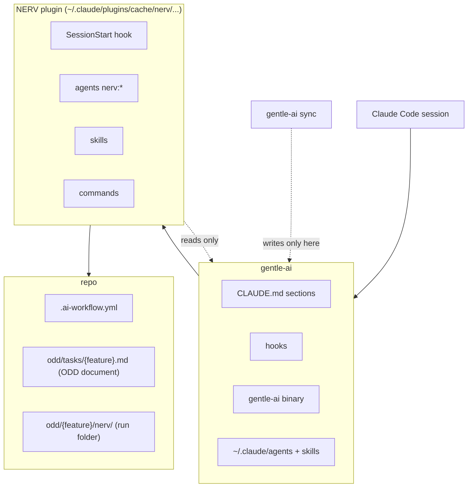
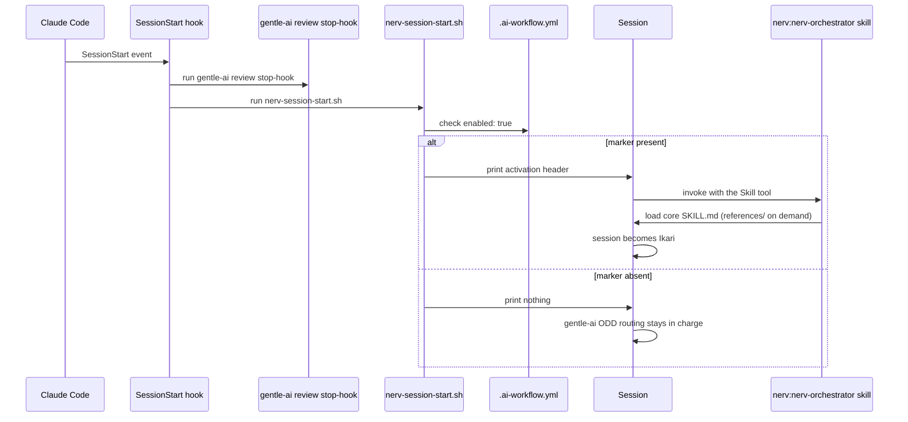
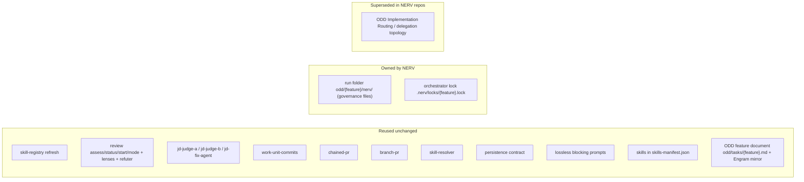
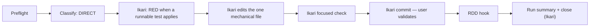
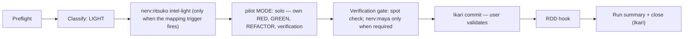
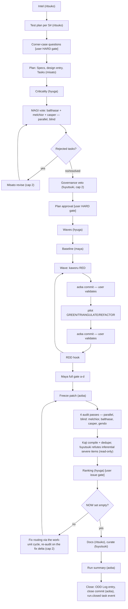
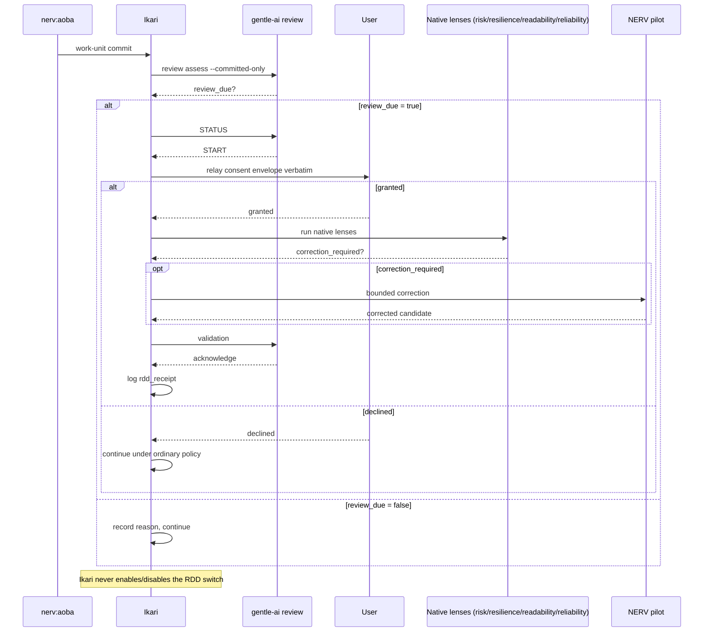

# How Nerv by Gentle-AI integrates with gentle-ai

### Layering



Nerv by Gentle-AI sits strictly above gentle-ai and below the repo it
governs: Claude Code loads gentle-ai first (`CLAUDE.md`, its hooks, the
`gentle-ai` binary, and the agents/skills it writes under `~/.claude`),
Nerv by Gentle-AI's plugin cache layers its own hook, agents, skills, and
commands on top, and the repo carries only the configuration
(`.ai-workflow.yml`), each feature's ODD document (`odd/tasks/<feature>.md`)
and its NERV run folder (`odd/<feature>/nerv/`), plus the git-ignored
runtime folder `.nerv/`. `gentle-ai
sync` never sees Nerv by Gentle-AI's files because Nerv by Gentle-AI never
writes into the gentle-ai box, and Nerv by Gentle-AI never writes into it
either — it only reads from it.

### Activation



Every session start runs gentle-ai's own `review stop-hook` first, then
Nerv by Gentle-AI's `nerv-session-start.sh`. The Nerv by Gentle-AI hook checks
`.ai-workflow.yml` for `enabled: true`; only then does it print a short
activation header — Claude Code caps hook stdout at 10,000 characters,
well under the full protocol's size, so the hook cannot inject the
protocol body itself. The header instructs the session to invoke the
`nerv:nerv-orchestrator` skill with the Skill tool, which is the moment
the session becomes Ikari; the skill's core stays under 500 lines and
loads its run-time sections from `references/` only at the phase that
names them. Without the marker the hook prints nothing at all, and
gentle-ai's own ODD Implementation Routing stays in charge of the session.

### Reuse map



Nerv by Gentle-AI calls a slice of gentle-ai's native engine completely
unchanged: `skill-registry refresh`, the whole RDD lifecycle, the `jd`
judgment agents, the delivery and skill-resolution skills listed in
`plugin/skills-manifest.json`, and the persistence and lossless-prompt
contracts. It supersedes exactly one thing — gentle-ai's ODD
Implementation Routing — with its own DIRECT/LIGHT/FULL classification and
pipelines, only in repos carrying the `.ai-workflow.yml` marker. It keeps
gentle-ai's ODD feature document as the tracking surface, and its own roles
(Misato, Ritsuko, the MAGI, the pilots) write it; see "NERV on ODD" below.

### NERV on ODD

Nerv by Gentle-AI runs on gentle-ai's ODD (Organic Driven Development) mode
with its agents on top. ODD gives every piece of work one feature document,
`odd/tasks/<feature>.md`, with a fixed shape: a short header (objective,
branch, delivery strategy, test runner), `## Specs` (`S1`..`Sn`, quoting
the user verbatim), `## Tasks` (one row per task with its route, status and
commit) and `## Log` (`L1` is the original request verbatim; corrections,
decisions and evidence are appended). Its Engram mirror is the topic
`odd/<feature>/tasks`. NERV keeps that document and that shape, and
replaces only ODD's routing and execution loop with its DIRECT, LIGHT and
FULL pipelines.

The roles write the document instead of separate plan files:

| Role output | Where it lives on ODD |
|---|---|
| the user's request | header, `L1`, and the seeded `S#` (Ikari, verbatim) |
| Misato's scope and acceptance criteria | `## Specs` |
| Misato's design, with `### New skills, scripts and commands` for Fuyutsuki | a design entry in `## Log` |
| Misato's tasks (pilot, dependencies) | `## Tasks` rows |
| Hyuga's criticality, the MAGI vote | the `Criticality` and `MAGI` columns of each task row (detail in `nerv/criticality.md` and `nerv/votes.md`) |
| Ritsuko's test plan and the corner-case answers | a test-plan entry in `## Log`, cases per `S#` |
| gate decisions, rulings, Maya's verdict, the close | `## Log` entries |
| each work-unit commit | the `Commit` column of its task row |

NERV's own governance files sit next to the document in the run folder
`odd/<feature>/nerv/`: `state.yaml` (with `feature`, the tier and the task
ref), the deliberation log, `task-events.yaml`, the audit rounds
(`audit/diff-round-N.patch`, `round-N.yaml`, `commits-round-N.txt`), the
votes, rulings, reports and the run summary. They are committed with the
feature, per `artifacts.commit`. The orchestrator lock is runtime state and
lives in `.nerv/locks/<feature>.lock`, never committed.

There is no archive step and no spec composition: a feature closes in
place, when every task row has its commit, the `## Log` records the close,
and the close commit (`docs: close nerv run for <feature>`) lands. Resume
follows ODD's order — `mem_context`, `mem_search` for the feature,
`mem_get_observation`, then the document itself — before NERV's lock check
and reconciliation. The TDD mode and the test runner are resolved per
feature and recorded in the document's header. `nerv migrate` converts an
older repository's `openspec/changes/` still in progress into ODD
documents.

### Routing tiers

Ikari classifies every request once, before the first agent launch, into
one of three tiers. DIRECT and LIGHT mirror gentle-ai's Work Routing Ladder
(direct inline and delegated direct) with the same thresholds — an inline
evidence budget of one parallel batch (at most 3 calls, about 10k tokens),
one read-only explorer past about 5 sequential lookups, one bounded writer
for 2+ non-trivial files — and FULL is NERV's governed pipeline. FULL is
checked first (2+ pilot domains, a critical path, a new skill/script/command,
a large or multi-unit diff), then DIRECT; anything else is LIGHT. Size or
file count alone never picks between DIRECT and LIGHT. The classification
event in the deliberation log is the route declaration (tier plus trigger
evidence), and the ratchet only goes up: DIRECT → LIGHT → FULL.

### DIRECT pipeline



DIRECT is gentle-ai's direct-inline route: a typo, rename, comment, config
value or small known bug in one already-understood file. Ikari edits it
itself (the only tier where it may), runs the focused check, shows the
commit for the user to validate, and runs the RDD hook. No agent is
launched except Maya only when RDD is off or unknown and the native
assessment is high or unassessable. With the task plugin installed, Ikari
also emits the task events through `task:dispatcher`.

### LIGHT pipeline



LIGHT is gentle-ai's delegated-direct route with the fewest agents: an
optional Ritsuko explorer (at most ~2k tokens), one domain-matched pilot in
`MODE: solo` that writes and observes its own failing test before making it
pass and reports the named verification commands, then gentle-ai's
Delegated Verification Gate — with RDD on, the pilot's report is of record
and the native review is the independent check; with RDD off or unknown,
the native risk tier decides (passive: readback; medium: self-verification,
plus Maya for a small-model pilot; high: Maya as independent verifier).
Ikari always re-runs one reported command, then commits once the user
validates. Ikari writes the run summary and makes the close commit; Aoba
is launched only for PR preparation or slicing.

### FULL pipeline



FULL adds MAGI governance on top of the shared primitives (RED/GREEN/
REFACTOR, user-validated commits, RDD hook) and keeps its own work-unit
cycle: Kaworu RED, Aoba commit, pilot GREEN, Aoba commit. Ritsuko produces intel and a test
plan per `S#`, gated by a user corner-case interview; Misato's plan
(`## Specs`, a design entry and `## Tasks` in the ODD document) goes through
criticality, a blind parallel MAGI vote (with a capped revise loop on
rejection), and Fuyutsuki's governance veto before a single whole-plan user
approval gate. Hyuga's waves then drive per-task implementation cycles
through that cycle, and Maya runs the full a-d gate. The audit stage then
freezes the patch, runs four blind passes, compiles them through Kaji (with
Fuyutsuki's read-only refute mode on inferential severe items), ranks the issues for a user gate,
routes approved fixes through the work-unit cycle with a re-audit over the
fix delta (capped at 2), and closes with Ritsuko's documentation,
Fuyutsuki's log summary, the run summary, the close on the ODD document
and, with the task plugin installed, the `run.closed` event.

### RDD per commit



After every Aoba work-unit commit, Ikari assesses that commit against the
last reviewed boundary. When review is due, Ikari relays gentle-ai's native
consent envelope to the user losslessly and verbatim — never deciding on
their behalf. On a grant, the native lenses run, a bounded correction from
a Nerv by Gentle-AI pilot applies only if one is required, and an
acknowledged receipt is
logged as `rdd_receipt`; on a decline, the run continues under ordinary
repository policy. Ikari itself never enables or disables the RDD switch.
Untracked Nerv by Gentle-AI paths (`.nerv/`, and the ODD document and run
folder before they are committed) never need a
`.git/info/exclude` entry from the user: Ikari declares the untracked scope
to `review assess` itself (`--untracked-scope=select` with the real new
files, or `exclude` when only those folders are untracked), because
gentle-ai has no per-path exclude flag.

## Roles

For each role's one-line purpose, the gentle-ai v4 agents it covers and its
default model/effort, see the roles table in
[Configuration](configuration.md#roles-and-their-gentle-ai-equivalents).

Ikari is the main Claude Code session itself, not a spawnable agent — the
sole spawner that launches every role below, classifies each request,
relays every blocking gate to the user, and never delegates that
authority to anyone it launches.

| Agent | Role | Runs when | Produces | Default model / effort | Tools (summary) |
|---|---|---|---|---|---|
| `fuyutsuki` | Governance veto over new skills/scripts/commands; curates the deliberation log; in a read-only refute mode (no writes, no `mem_save`, no new findings), attacks the round's inferential BLOCKER/CRITICAL audit findings with concrete counter-evidence | FULL plan step, after the MAGI vote; end of every run; Phase 3, only when Kaji's refuter batch is non-empty | `nerv/veto-ruling.md`; curated `## Summary` in `nerv/deliberation-log.md`; corroborated/refuted/inconclusive verdicts, folded by Kaji into `nerv/audit-report.md`'s `### Refuted` | sonnet / medium | Read, Write, Glob, Grep, Engram search/save |
| `misato` | Operations director — authors the ODD document's `## Specs`, design entry and `## Tasks`, revises exactly what the MAGI vote rejects, rules on deviations and test-vs-implementation disputes | FULL plan step; after a rejected MAGI vote or a veto; on demand for a ruling | `## Specs`, the design `## Log` entry and `## Tasks` of `odd/tasks/<feature>.md`; ruling entries | fable / high | Read, Write, Glob, Grep, Engram search/save |
| `ritsuko` | Chief scientist — codebase/history intel, test planning with a corner-case interview, end-of-run docs | LIGHT micro-intel when the mapping trigger fires; FULL intel and test-plan steps; end-of-run documentation | `exploration-light.md`/`exploration.md`, the test-plan `## Log` entry (cases per `S#`), doc updates | opus / high | Read, Glob, Grep, WebFetch, WebSearch, Engram search/save |
| `balthasar` | MAGI vote (VOTE mode): software-principles lens — SOLID, KISS, YAGNI, DRY, patterns; also an AUDIT-mode pass in Phase 3 that applies the same lens to the delivered change, plus a readability lens (misleading names, unexplained constants, complexity, intention, review size and context) | FULL blind MAGI vote round, per task; Phase 3 audit round | VOTE/AUDIT JSON, merged by Ikari into `nerv/votes.md`/`nerv/audit-report.md` | sonnet / medium | Read, Glob, Grep, Engram search |
| `melchior` | MAGI vote (VOTE mode): structure/security lens — architecture, dead code, duplication, security; the deliberately strongest MAGI model; also an AUDIT-mode pass in Phase 3 that adds security across every layer (injection, authz, secrets, data exposure, unsafe defaults, dependencies, crypto, infra hardening) | same | same | fable / high | Read, Glob, Grep, Engram search |
| `casper` | MAGI vote (VOTE mode): process lens — docs, comments, scope, commit hygiene, plan consistency; its AUDIT-mode pass also checks plan conformance and TDD commit order, always at full scope | same | same | sonnet / medium | Read, Glob, Grep, Engram search |
| `rei` | Pilot — owns data: persistence, migrations, caches, observability, and that layer's security | GREEN/REFACTOR after Kaworu's RED, on data work units | source and tests in the working tree, TDD evidence | sonnet / medium | Read, Edit, Write, Glob, Grep, Bash, Engram search |
| `shinji` | Pilot — owns the backend and its security | GREEN/REFACTOR after Kaworu's RED, on backend work units | source and tests in the working tree, TDD evidence | sonnet / medium | Read, Edit, Write, Glob, Grep, Bash, Engram search |
| `asuka` | Pilot — owns the frontend: UI, state, accessibility, and client-side security | GREEN/REFACTOR after Kaworu's RED, on frontend work units | source and tests in the working tree, TDD evidence | sonnet / medium | Read, Edit, Write, Glob, Grep, Bash, Engram search |
| `toji` | Pilot — owns infrastructure: CI/CD, Docker, Kubernetes, and infra security | GREEN/REFACTOR after Kaworu's RED, on infra work units (validation commands substitute for RED/GREEN where no runner exists) | source, manifests and pipelines in the working tree, TDD evidence or a validation-commands report | sonnet / medium | Read, Edit, Write, Glob, Grep, Bash, Engram search |
| `kaworu` | Pilot — writes the failing RED test first for every work unit, before any pilot's GREEN step; never a domain owner | before every GREEN step in FULL (LIGHT pilots write their own RED in `MODE: solo`) | the RED test file; RED row of the TDD Cycle Evidence table | sonnet / medium | Read, Edit, Write, Glob, Grep, Bash, Engram search |
| `maya` | Quality gate — runs tests/lint/build, reproduces the TDD evidence pilots reported, routes failures to whoever owns them | LIGHT or DIRECT reduced gate when the verification gate requires an independent verifier; FULL baseline (phase 0) and full a-d gate (phase 2) | `nerv/maya-report.md` | sonnet / medium | Read, Bash, Glob, Grep, Write, Engram search/save |
| `kaji` | Audit compiler — merges and dedupes the four audit passes, prepares the refuter batch, carries unresolved items across re-audit rounds | Phase 3, once per audit round, after the four passes return | `nerv/audit-report.md` | opus / high | Read, Glob, Grep, Write, Engram search/save |
| `gendo` | Audit pass — implemented tests versus Ritsuko's test plan (missing cases, weakened or tautological assertions, untested acceptance criteria), reliability beyond the plan (invalid inputs, failure paths, contracts, boundaries, regressions, determinism), implementation correctness and edge cases, and resilience and performance: fallbacks and graceful degradation, retry/backoff safety, timeouts and cancellation, rollback or fix-forward safety, latency/load/resource use and SLO risk, performance regressions (N+1, unbounded loops or allocations, blocking I/O on hot paths, missing pagination, accidental quadratic work), observability of failures; keeps full scope regardless of the RDD switch | Phase 3, one of four parallel blind passes | JSON findings, merged by Kaji into `nerv/audit-report.md` | sonnet / medium | Read, Glob, Grep, Engram search |
| `hyuga` | Plan and issue operations — four dispatches: `criticality`, `waves`, `wave-report`, `ranking` | criticality before the MAGI vote; waves after plan approval; wave-report during implementation; ranking after the refuter | `nerv/criticality.md`, `nerv/waves.md`, `nerv/issue-ranking.md` | sonnet / medium | Read, Write, Glob, Grep, Bash, Engram search/save |
| `aoba` | Git operations and run telemetry — organizes user-validated commits, freezes audit patches, writes the run summary and the close commit | in FULL: after every user-validated work unit, patch freeze before each audit round, run summary and close commit at close; in DIRECT/LIGHT only for PR preparation or slicing | conventional commits, `nerv/audit/diff-round-N.patch`, `nerv/run-summary.md`, the close commit | sonnet / low | Bash, Read, Glob, Grep, Write, Engram search/save |

**How a run flows.** Every request is classified once, before the first
agent launch: DIRECT for one mechanical, already-understood file, LIGHT
for a single-domain change that needs a delegated writer, FULL for anything
touching two or more pilot domains, a critical path, a new
skill/script/command, or a large diff. DIRECT is Ikari's own inline edit;
LIGHT runs one pilot in `MODE: solo` under gentle-ai's Delegated
Verification Gate — both shown in their diagrams above, both with
Ikari's user-validated commit. FULL adds Ritsuko's spec and
corner-case interview, Misato's plan, a blind per-task MAGI vote,
Fuyutsuki's governance veto, a whole-plan approval gate, Hyuga's
dependency waves, Maya's full a-d gate, and a four-pass, Kaji-compiled
audit behind a ranked user issue gate, shown in the "FULL pipeline"
diagram above. Every tier shares the same user validation before each
commit and the same native RDD review relay after it, detailed in "RDD
per commit" above.

## Operations

**Activation.** A repo opts in by creating `.ai-workflow.yml` with
`enabled: true` — `/nerv:init` writes it interactively (base branch,
worktree policy, worktree location, skill stacks),
and `/nerv:configure`
revisits any of those choices afterwards. Without the marker a session
behaves like plain gentle-ai; with it, SessionStart prints an activation
header that has the session invoke the Nerv by Gentle-AI orchestrator skill,
and the session becomes Ikari.

**DIRECT, LIGHT or FULL.** Ikari classifies each request DIRECT (one
mechanical file, done inline by Ikari), LIGHT (one pilot domain, one
pilot in `MODE: solo` under gentle-ai's verification gate) or FULL
(multiple domains, a critical path, or governance-relevant surface); FULL
adds Ritsuko's spec/test-plan,
a blind MAGI vote per task, Fuyutsuki's governance veto, a plan-approval
gate, wave-based implementation, and Kaji's four-pass audit before close.

**Gates a human will see.** The grouped preflight question (worktree,
branch, base), plus any task question the task plugin returns as
`needs_input` when it is installed; a commit-validation
stop before every commit (Ikari's in DIRECT/LIGHT, Aoba's in FULL); the corner-case questions relayed as one
grouped prompt in FULL; the whole-plan approval HARD gate in FULL; the
ranked issue gate after an audit; and the RDD consent envelope after a
commit when review is due. Every one of these is a Lossless Blocking
Prompt — relayed verbatim, never decided on the user's behalf. While one is
open the orchestrator lock carries `waiting_on: user`, so the 15-minute
staleness rule does not apply to it: a resume from another session must
ask before taking over, however long the gate stays open.

**Artifacts.** Nerv by Gentle-AI writes each feature's ODD document
(`odd/tasks/<feature>.md`) and its run folder `odd/<feature>/nerv/`
(`state.yaml`, deliberation log, exploration, votes, veto ruling, waves,
Maya reports, audit rounds, run summary, and `task-events.yaml` when the
task plugin is installed), plus the lock under `.nerv/locks/`; see "NERV
on ODD" above. `.ai-workflow.yml` (project scope) and
`~/.config/ai-workflow/config.yml` (user scope) hold configuration; nothing is
ever written under `~/.claude/agents` or `~/.claude/skills`.

**Artifacts commit policy.** `artifacts.commit` controls when the ODD
document and the run folder are committed: `with-change` (each work-unit
commit includes the document and run-folder files it touched), `at-close`
(default — they land in the `docs: close nerv run for <feature>` commit
when the run closes), or `never` (they stay untracked; the user commits
them manually, if ever). When the repository git-ignores them (checked
with `git check-ignore`; `.nerv/` is runtime only and always ignores
itself), the artifacts stay local whatever this says: no close commit,
and the run summary says so. The lock file is never staged.

**`/nerv:status`.** Reports gentle-ai major-version compatibility, the
active config (merged user + project), and — while a run is in progress —
the orchestrator lock state (`.nerv/locks/<feature>.lock`: holder, step,
`waiting_on`, heartbeat age); the lock line disappears once the run closes.
It also prints whether the task plugin is installed (`task:dispatcher`
available); timers are shown by `/task:timers`.

**`/nerv:configure`.** Configures `config.yml` (user scope) and `.ai-workflow.yml` (project scope),
per-role models, skills, and repository registration through grouped
guided questions instead of hand-editing YAML or the terminal wizard — see
"Setup" in [README.md](../README.md). Read-only in `claude -p`, where it
prints the current config and the exact `--set`/`--set-model` syntax
instead of asking.

### Task plugin

Core holds no task, timer or tracker logic. Task tracking is split across
optional plugins from the same marketplace:

- **`task@nerv`**, the task plugin. It owns the `/task:*` commands, the
  local timer store, timelog consolidation, the composite operations
  (block, cancel, done, close, stopAll) and the `task:dispatcher` agent.
  Its contract is `plugins/task/skills/task/SKILL.md`.
- **Provider plugins**, such as `task-teamwork@nerv`. Each one ships a
  `provider.yaml` manifest and one procedure file per remote operation.

**Detection.** The orchestrator treats the task plugin as installed when
the agent type `task:dispatcher` is available in the session. When it is
not, a run asks no task question, emits no event, writes no `task_event`
log entry and creates no `task-events.yaml`.

**Events.** With the task plugin installed, Ikari launches
`task:dispatcher` with one event at each hook point:

| Event | Emitted when | Provider operations |
|---|---|---|
| `run.started` | Preflight, after classification | `getTask`, `assign`, `moveStage` (plus the local timer) |
| `verification.started` | Maya's full gate starts (FULL), or the work unit's verification starts (LIGHT, DIRECT) | `moveStage` |
| `audit.ranked` | The FULL issue ranking is accepted | `comment` |
| `issue.deferred` | Once per accepted `DEFER` issue | `createTask` |
| `wave.started` | A FULL wave starts (a subtask only with `tasks.subtasks_per_wave: true`) | `createSubtask` |
| `run.closed` | The run closes complete | `moveStage`, `logTime`; it never completes the task, which stays an explicit `/task:close` |
| `run.halted` | The run halts, with the cause in `data` | `comment`, `moveStage`, `logTime` |

Every event carries `task_ref`, `repo`, `change`, `branch`, `worktree`,
`session_id`, `data` and `disabled_events`. The `task_ref` returned by
`run.started` feeds `git.branch_pattern` (`{prefix}`, `{id}`),
`git.commit_ref_pattern` and the change's `state.yaml`.

**Envelope.** The dispatcher answers one envelope per provider:

```yaml
- event: run.started
  provider: teamwork
  result: ok            # ok | skipped | blocked | failed | needs_input
  task_ref: TW-49076279
  data: {stage: "En Desarrollo", timer: started}
  error: "<exact error text>"   # when blocked or failed
  replay: true                   # when re-dispatching later can still apply it
```

A `needs_input` envelope carries a question; Ikari relays it verbatim and
dispatches the event again with the answer in `data`. Dispatch is
fail-soft: a `blocked` or `failed` envelope never halts or retries the run.

**Per-event switches.** `tasks.events.<event>: off` in either configuration file
scope turns one event off, and a run can switch events off for itself
(`disabled_events`). A switched-off event is answered `skipped`. See
[configuration.md](configuration.md#tasks-task-plugin).

**`task-events.yaml` and `/task:replay`.** Ikari appends every envelope to
`odd/<feature>/nerv/task-events.yaml` and logs one `task_event`
entry `{event, provider, result, task_ref}` in the deliberation log. An
envelope that is `blocked` or `failed` with `replay: true` stays pending:
the run summary lists it under "Task events pending" with the hint
`/task:replay <feature>`, which dispatches the pending envelopes again, in
order, once the cause is fixed.

**Adding a provider.** A new tracker is a new plugin, with no change to core
or to the task plugin. It ships a `provider.yaml` that declares its `name`,
`contract_version`, `task_ref_prefix`, the MCP server and exact tool names
it calls, its `config` keys (scope, type, default, prompt), its canonical
stage map, one procedure file per operation (or `not_implemented`), and the
events it subscribes to. `nerv` validates every manifest it ships: an event
whose operations are `not_implemented` makes the manifest invalid. At
dispatch time the provider is skipped as `blocked`, naming the missing
tools, when the session lacks any MCP tool the manifest declares.

**Commands.** The `/task:*` commands are served by the `task` plugin, so
nothing is copied to `~/.claude/commands/task/` any more. They read the
same configuration files (user `config.yml` and project `.ai-workflow.yml`) as the rest of NERV.

### Engram project detection

A second SessionStart hook, `plugin/hooks/nerv-engram-project.sh`, runs in
**every** session — unlike the Nerv by Gentle-AI activation hook above, it is
not gated behind `.ai-workflow.yml` — to tell the session which Engram
project to pass
on every memory write. It detects the project in this order:

1. `.engram/config.json` in the session directory, then in the git
   toplevel (so a nested subfolder still honors the repo-root config), if
   it declares a `project_name` that passes validation: letters, digits,
   dot, underscore, dash, 1–64 characters, alphanumeric first. The name
   `nerv` is reserved for the knowledge base and is refused from any repo
   config (warning on stderr, detection falls through). A repository you
   merely open can therefore not redirect your memory writes to an
   arbitrary or reserved project.
2. Otherwise, the basename of the git toplevel directory (works from any
   nested subfolder).
3. Otherwise, undetermined.

Inside a NERV-enabled repo (`.ai-workflow.yml` with `enabled: true`), the
hook also prints a reminder that Nerv by Gentle-AI keeps a shared knowledge
base in the Engram project named `nerv` — precedents (Misato rulings,
Fuyutsuki vetoes,
MAGI vote results, Kaji audit findings) mirrored from every NERV-governed
repository under topic keys `nerv/kb/{repo}/{feature}/{artifact}`, read
before deciding and written back after. When detection is undetermined in
a Nerv by Gentle-AI repo, the hook falls back to `project: "nerv"` for that
session's
writes instead of leaving it unresolved.

Outside a Nerv by Gentle-AI repo, an undetermined detection is never
silently guessed:
the hook asks the session to pose one question to the user — general
knowledge under the `root` project, or a specific named project — before
the first Engram write (`mem_save`, `mem_session_summary`, `mem_context`).

`nerv install` keeps a `nerv` Engram project provisioned: when
`engram` is on PATH, it checks `engram projects list` and
creates the `nerv` knowledge-base project if it is missing (idempotent —
a second run makes no changes). Without `engram` on PATH, it warns and
continues; nothing about plugin registration depends on it.
